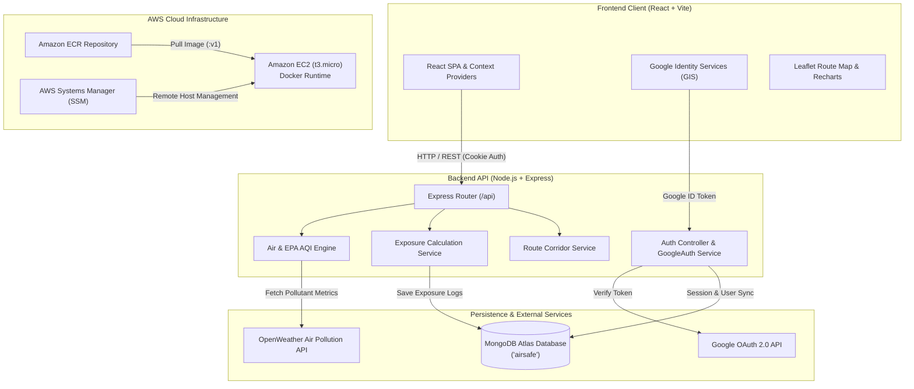

# AirSafe

> **Turning real-time air quality into personalized exposure insights and safer everyday decisions.**

AirSafe is a full-stack personal air pollution intelligence platform. While standard weather applications display abstract city-wide Air Quality Index (AQI) numbers, AirSafe calculates how ambient air pollution physically impacts an individual based on their specific outdoor activity, exertion level, and exposure duration.

Developed for the **WeMakeDevs × AWS Hackathon**, AirSafe provides real-time EPA AQI calculations, personal exposure dosage modeling, forecast-based clean activity windows, pollution-aware route comparisons, campus safety directives, and Google OAuth 2.0 authentication.

---

## 1. Problem Statement & Solution

### The Problem
Ambient air pollution (particulate matter $\text{PM}_{2.5}$, $\text{PM}_{10}$, ground-level $\text{O}_3$, $\text{NO}_2$, $\text{SO}_2$, and $\text{CO}$) causes severe pulmonary and cardiovascular stress. However, traditional air quality reporting presents significant limitations:
- **Static & Generic**: A single regional AQI reading does not reflect personal exposure. A runner inhaling 60 liters of air per minute experiences drastically higher pulmonary pollutant deposition than an individual sitting on a park bench.
- **Action Deficit**: Alerts rarely tell users *when* it is safe to exercise, *which* commute corridor has lower particulate density, or *how* schools should regulate outdoor physical activities.

### The Solution
AirSafe translates raw pollutant mass concentrations ($\mu\text{g/m}^3$) into actionable, personalized intelligence:
1. **Human Exertion Modeling**: Adjusts exposure doses using scientific metabolic ventilation multipliers (e.g., Running at $3.5\times$ baseline vs. Walking at $1.8\times$).
2. **Proactive Planning**: Scans 24-hour and 7-day hourly forecasts to identify the cleanest upcoming outdoor windows.
3. **Route Exposure Analysis**: Compares standard transit corridors against lower-pollution "Green Corridors".
4. **Institutional Safety**: Provides schools with real-time, AQI-stratified activity directives adhering to safety standards.

---

## 2. Key Implemented Features

### Implemented & Verified in Codebase
- **Public Landing Page (`/`)**: Hero section, live air quality preview, feature showcases, calculation methodology, FAQ, and responsive mobile navigation.
- **Google OAuth 2.0 Authentication (`/login`, `/signup`)**: Google Identity Services (GIS) integration, cryptographic server-side token verification, MongoDB Atlas user profiles, and secure HTTP-only session cookies. Includes an interactive Demo Mode for evaluation.
- **Live Air Quality Dashboard (`/dashboard`)**: Real-time US EPA AQI calculation, category indicators (Good to Hazardous), dominant pollutant detection, and full chemical breakdown ($\text{PM}_{2.5}$, $\text{PM}_{10}$, $\text{O}_3$, $\text{NO}_2$, $\text{SO}_2$, $\text{CO}$).
- **Personal Exposure Calculator (`/exposure`)**: Calculates cumulative pollution doses and a normalized 0–100 risk score based on activity type (Running, Cycling, Walking, Chores, Sports, Commuting) and duration (1–720 minutes).
- **Forecast & Clean Windows (`/forecast`)**: Visualizes 24-hour hourly projections and 7-day multi-day trends using Recharts, highlighting the safest outdoor time window.
- **Pollution-Aware Route Comparison (`/routes`)**: Interactive Leaflet maps contrasting a direct transit route against a recommended "Green Corridor" with simulated exposure scores.
- **Exposure History (`/history`)**: Aggregated outdoor hours, average exposure index, and persistent session logs stored in MongoDB Atlas.
- **Campus Safe Mode (`/school`)**: Automated activity directives (Morning Assembly, PE & Sports, Recess, Ventilation) mapped to real-time campus AQI with WCAG AA compliant contrast.
- **Emergency Simulation Mode**: Toggle to simulate rapid air pollution spikes (Hazardous 275+ AQI) with AWS SNS emergency push and SMS alert simulation.
- **Accessible Design System**: Dark and light themes with curated color tokens and responsive layouts.

### Planned & Experimental Features
- Integration with consumer wearable health platforms (Apple HealthKit / Google Health Connect) for automatic breathing rate calibration.
- Native mobile push notification dispatch via direct AWS SNS mobile endpoint registrations.
- Dynamic turn-by-turn navigation with real-time GPS re-routing around temporary pollution hotspots.

---

## 3. How AirSafe Works

### 1. US EPA Piecewise Linear AQI Calculation
Rather than relying on generic index estimates, AirSafe applies the standard US EPA linear interpolation formula across all monitored pollutants:

$$I_p = \frac{I_{\text{high}} - I_{\text{low}}}{C_{\text{high}} - C_{\text{low}}} \times (C_p - C_{\text{low}}) + I_{\text{low}}$$

Where:
- $C_p$ is the truncated concentration of pollutant $p$.
- $C_{\text{low}}, C_{\text{high}}$ are the concentration breakpoints containing $C_p$.
- $I_{\text{low}}, I_{\text{high}}$ are the index breakpoints corresponding to the category range.
- Overall $\text{AQI} = \max(I_{\text{PM2.5}}, I_{\text{PM10}}, I_{\text{O3}}, I_{\text{NO2}}, I_{\text{SO2}}, I_{\text{CO}})$.

### 2. Activity-Adjusted Exposure Dosage Model
The exposure calculation engine estimates total particulate inhalation:

$$\text{Exposure Dose} = f(\text{AQI}, \text{PM}_{2.5}) \times \text{BreathingRateMultiplier} \times \left(\frac{\text{Duration (min)}}{60}\right)$$

#### Ventilation Multipliers
| Activity | Ventilation Multiplier | Physiological Context |
| :--- | :---: | :--- |
| **Running / Jogging** | $3.5\times$ | High cardiovascular exertion, oral breathing predominant |
| **Cycling** | $2.8\times$ | Sustained elevated minute ventilation |
| **Sports / Training** | $3.0\times$ | Interval anaerobic and aerobic bursts |
| **Walking / Commuting** | $1.8\times$ | Moderate physical movement |
| **Outdoor Chores** | $1.5\times$ | Light intermittent physical activity |
| **Resting / Stationary** | $1.0\times$ | Baseline resting tidal volume |

The raw dose is translated into an **Exposure Score (0–100)** and mapped to risk tiers (`Low`, `Moderate`, `High`, `Critical`) with actionable mitigation advisories.

---

## 4. Application Architecture & Request Flow



---

## 5. Technology Stack

| Domain | Technologies |
| :--- | :--- |
| **Frontend** | React 18.3, Vite 6.1, Tailwind CSS 3.4, React Router v6.28, Axios, Recharts 2.15, Leaflet 1.9, React-Leaflet 4.2, Lucide React |
| **Backend** | Node.js 22, Express.js 4.19, Mongoose 9.11, Google Auth Library 11.2, Cookie-Parser, CORS, Dotenv |
| **Database** | MongoDB Atlas (Mongoose ODM, targeted database: `airsafe`) |
| **External APIs** | OpenWeather Air Pollution API, Google Identity Services, OpenStreetMap / Nominatim |
| **Containers** | Docker (multi-stage builds, Alpine base images), Docker Compose |
| **CI / CD** | GitHub Actions (`.github/workflows/ci.yml`) testing and building on Node.js 22 |
| **Infrastructure as Code** | Terraform (`>= 1.5.0`, AWS provider `~> 6.0`) |
| **Cloud Hosting** | AWS (Amazon EC2 `t3.micro`, Amazon ECR, IAM Roles & Instance Profiles, Systems Manager) |

---

## 6. Repository Structure

```text
AirSafe/
├── .github/
│   ├── workflows/
│   │   └── ci.yml             # GitHub Actions CI workflow (frontend + backend)
│   └── pull_request_template.md # PR description and testing checklist
├── client/                    # React 18 + Vite frontend application
│   ├── public/                # Static public assets
│   ├── src/                   # React components, pages, contexts, services
│   ├── .dockerignore
│   ├── .env.example           # Client environment template
│   ├── Dockerfile             # Multi-stage production container build (Nginx)
│   ├── nginx.conf             # Production Nginx reverse proxy configuration
│   ├── package.json
│   ├── tailwind.config.js
│   ├── vite.config.js
│   └── README.md              # Dedicated client documentation
├── server/                    # Node.js + Express backend REST API
│   ├── src/                   # Controllers, routes, models, services, utils
│   ├── tests/                 # Jest + Supertest test suites (11 files, 179 tests)
│   ├── .dockerignore
│   ├── .env.example           # Server environment template
│   ├── Dockerfile             # Production container build (Node 22 Alpine)
│   ├── package.json
│   └── README.md              # Dedicated server documentation
├── terraform/                 # AWS Infrastructure as Code
│   ├── main.tf                # ECR, EC2, IAM, Security Groups
│   ├── outputs.tf             # ECR URL, EC2 IP, API URL
│   ├── providers.tf           # AWS provider and profile
│   ├── variables.tf           # Region and project name variables
│   ├── versions.tf            # Terraform and AWS provider versions
│   ├── .terraform.lock.hcl    # Pinned provider checksums
│   └── README.md              # Dedicated infrastructure documentation
├── docs/                      # Architectural documentation & contracts
│   ├── api-contract.md        # Shared frontend/backend API contract
│   └── architecture.md        # Architectural system overview
├── docker-compose.yml         # Local multi-container development orchestration
├── LICENSE                    # MIT License
└── README.md                  # Project root overview
```

---

## 7. Live Demo & Deployment Information

During development and hackathon demonstration, AirSafe has been deployed across the following architecture:
- **Frontend**: Deployed on [Vercel](https://vercel.com/) at:
  ```text
  https://air-safe-nu.vercel.app/
  ```
- **Backend**: Containerized in Docker and hosted on an **AWS EC2 `t3.micro`** instance provisioned via Terraform and pulled from **Amazon ECR**.
- **Database**: Cloud-hosted **MongoDB Atlas** M0 cluster connected securely over TLS.
- **Temporary Demo API Tunnel**: For the live demo, HTTPS API access to the EC2 backend was routed through a temporary Cloudflare Quick Tunnel:
  ```text
  https://inexpensive-leslie-sports-goto.trycloudflare.com
  ```
  *(Note: This Cloudflare URL is a temporary development tunnel used to provide HTTPS for Google OAuth cookie requirements and may expire or change.)*
- **AWS Infrastructure Status**: The static frontend bundle was successfully uploaded to an Amazon S3 bucket; however, Amazon CloudFront distribution provisioning was pending AWS account verification. To ensure zero downtime, the live frontend was deployed to Vercel.

---

## 8. Prerequisites

Ensure the following tools are installed locally:
- **Node.js**: Version `18.x`, `20.x`, or `22.x` (LTS recommended)
- **npm**: Version `9.x` or later
- **Docker & Docker Compose**: For containerized execution
- **Terraform CLI**: Version `>= 1.5.0` (for infrastructure provisioning)
- **AWS CLI**: Configured with credentials for AWS deployments
- **Accounts & Keys**:
  - [MongoDB Atlas](https://www.mongodb.com/cloud/atlas) account and database URI
  - [OpenWeather API](https://openweathermap.org/api) key (Air Pollution API access)
  - [Google Cloud Console](https://console.cloud.google.com/) OAuth 2.0 Web Client ID

---

## 9. Local Installation & Startup

### Clone the Repository
```bash
git clone https://github.com/nithing007/AirSafe.git
cd AirSafe
```

### 1. Backend Setup
From the repository root:

**Windows (PowerShell):**
```powershell
cd server
Copy-Item .env.example .env
npm install
npm run dev
```

**macOS / Linux (Bash):**
```bash
cd server
cp .env.example .env
npm install
npm run dev
```

The backend starts on `http://localhost:3000` (or `http://localhost:5000` depending on `PORT`).

### 2. Frontend Setup
In a new terminal window:

**Windows (PowerShell):**
```powershell
cd client
Copy-Item .env.example .env
npm install
npm run dev
```

**macOS / Linux (Bash):**
```bash
cd client
cp .env.example .env
npm install
npm run dev
```

The frontend will start at `http://localhost:5173`.

---

## 10. Environment Variable Setup

AirSafe uses separate environment configurations for client and server. Refer to the template files:
- [client/.env.example](client/.env.example)
- [server/.env.example](server/.env.example)

### Client Variables (`client/.env`)
```ini
VITE_API_BASE_URL=http://localhost:5000/api
VITE_USE_MOCK_DATA=false
VITE_OPENWEATHER_API_KEY=your_openweather_key
VITE_GOOGLE_CLIENT_ID=your-google-oauth-client-id.apps.googleusercontent.com
```

### Server Variables (`server/.env`)
```ini
PORT=5000
NODE_ENV=development
CORS_ORIGIN=http://localhost:5173
MONGODB_URI=mongodb+srv://<username>:<password>@cluster0.abcde.mongodb.net/airsafe?retryWrites=true&w=majority
MONGODB_DB_NAME=airsafe
OPENWEATHER_API_KEY=your_openweather_api_key_here
GOOGLE_CLIENT_ID=your-google-oauth-client-id.apps.googleusercontent.com
SESSION_SECRET=replace-with-a-strong-random-secret
```

---

## 11. Running with Docker Compose

Run the entire AirSafe stack (backend container + frontend Nginx container) with a single command from the root directory:

```bash
docker-compose up --build
```

### Docker Compose Architecture
- **`server`**: Built from `server/Dockerfile` (Node 22 Alpine), exposes API on port `5000`, includes a healthcheck polling `/api/health`.
- **`client`**: Built from `client/Dockerfile` (Node 20 build -> Nginx Alpine), serves static assets on port `8081` and reverse-proxies `/api/` traffic directly to the `server` service.

Access the containerized application at:
```text
http://localhost:8081
```

To stop all containers:
```bash
docker-compose down
```

---

## 12. Testing and Build Verification

Both the client and server include comprehensive automated test suites.

### Run Frontend Tests & Build
```bash
cd client
npm test        # Runs Vitest (10 test suites, 45 tests)
npm run build   # Compiles production bundle using Vite
```

### Run Backend Tests
```bash
cd server
npm test        # Runs Jest with Supertest (11 test suites, 179 tests)
```

The backend test suite mocks all network and database calls, executing entirely offline without requiring live MongoDB or OpenWeather connections.

---

## 13. GitHub Actions CI Workflow

Automated continuous integration is defined in [`.github/workflows/ci.yml`](.github/workflows/ci.yml).

- **Triggers**: Runs on every `push` or `pull_request` targeting `main`, or via manual `workflow_dispatch`.
- **Concurrency**: Cancels redundant in-progress runs for the same branch.
- **Jobs**:
  1. `frontend-ci`: Sets up Node.js 22, installs client dependencies via `npm ci`, runs `npm test`, and validates `npm run build`.
  2. `backend-ci`: Sets up Node.js 22, installs server dependencies via `npm ci`, and executes `npm test`.

---

## 14. Terraform Infrastructure Setup

AWS resources are managed in the `terraform/` directory.

```bash
cd terraform
terraform init
terraform validate
terraform plan
```

For complete instructions regarding the ECR push prerequisite, IAM roles, and EC2 bootstrap, refer to [terraform/README.md](terraform/README.md).

---

## 15. Security Notes & Troubleshooting

- **No Committed Secrets**: Never commit `.env` files, AWS credentials, or Terraform state files. All are protected by `.gitignore`.
- **HTTP-Only Cookies**: Application sessions use `HttpOnly; SameSite=Lax` cookies, shielding authentication tokens from client-side cross-site scripting (XSS).
- **MongoDB Atlas Network Access**: If the server fails to connect on startup with a timeout, confirm that your current IP address is allowlisted in MongoDB Atlas Network Access.
- **CORS Credentials**: Ensure `CORS_ORIGIN` in `server/.env` exactly matches the frontend origin (protocol, domain, and port).

---

## 16. Known Limitations

1. **Simulated Route Corridors**: Route comparisons currently simulate waypoints and exposure deltas between input coordinates; full dynamic routing with real-time turn-by-turn re-routing is planned for future phases.
2. **OpenWeather API Limits**: The free tier of the OpenWeather Air Pollution API enforces rate limits (60 calls/minute). The backend incorporates in-memory caching to minimize upstream API calls.
3. **Demo Tunnel Expiration**: The Cloudflare Quick Tunnel used for hackathon HTTPS demonstrations is ephemeral and intended for evaluation purposes only.

---

## 17. Contribution Workflow

1. Fork the repository and create a feature branch (`git checkout -b feature/amazing-feature`).
2. Ensure all tests pass (`npm test` in both `client/` and `server/`).
3. Fill out the pull request template in [`.github/pull_request_template.md`](.github/pull_request_template.md).
4. Submit a pull request targeting `main`.

---

## 18. License

This project is licensed under the MIT License — see the [LICENSE](LICENSE) file for details.
